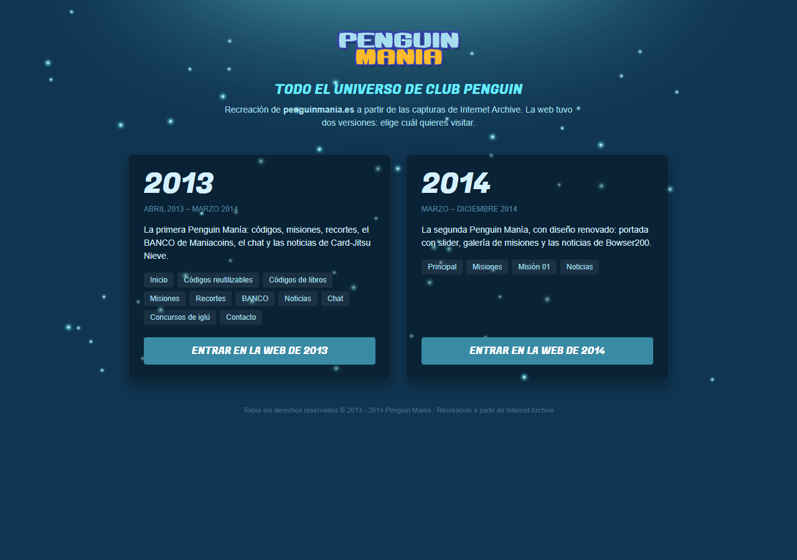
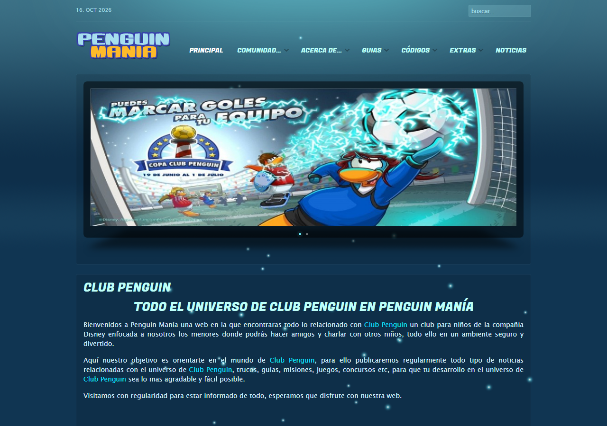
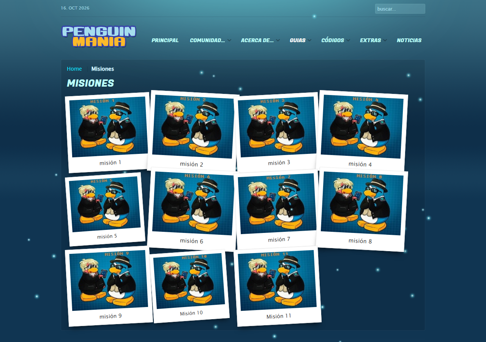
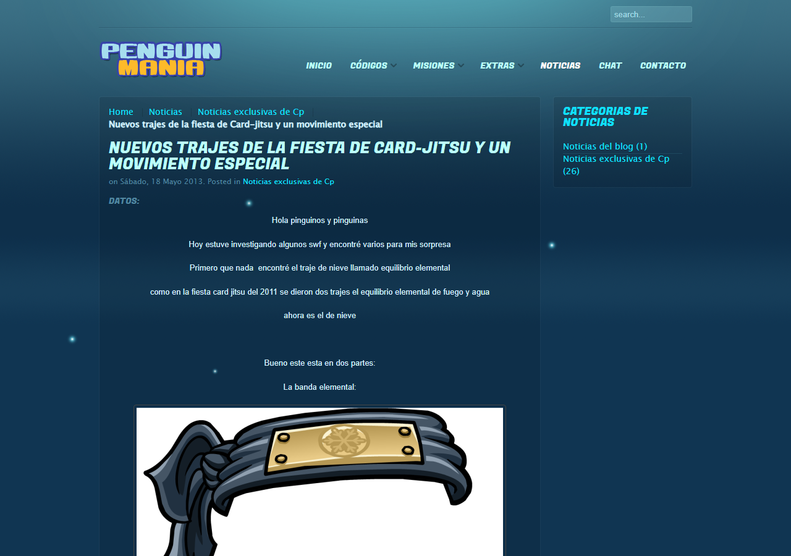

# PenguinMania 🐧

> *"Todo el Universo de Club Penguin en PenguinMania"*

**PenguinMania** (penguinmania.es) fue una web sobre **Club Penguin**, el juego de pingüinos de Disney, que hice con 9 años. Este repositorio la recupera tal y como era, a partir de lo que guardó Internet Archive.



## ¿Qué era PenguinMania?

Una web "para los maniáticos de Club Penguin", con:

- 🎁 **Códigos** para desbloquear ropa y monedas, también los de los libros.
- 🕵️ **Misiones** de la EPF explicadas una a una.
- ✂️ **Recortes** de pingüinos, puffles, gafas, fondos…
- 💬 Un **chat** con sus propias normas.
- 🏠 **Concursos de iglús**.
- 🏦 Un **BANCO** con moneda propia: los **Maniacoins**.
- 📰 Las **noticias** de la isla (Card-Jitsu Nieve, la fiesta de Marvel, los Muppets…), firmadas como **Bowser200**.

## Dos versiones

La web tuvo dos vidas y aquí se pueden visitar las dos, cada una con su menú original.

| | 2013 | 2014 |
|---|---|---|
| Estuvo en línea | abril 2013 – 6 de marzo de 2014 | 7 de marzo – diciembre 2014 |
| Qué conserva | portada, códigos, misiones, recortes, BANCO, chat, concursos y **27 noticias** | portada con slider, galería de misiones y **10 noticias** |

El cambio de una a otra fue literalmente de un día para otro. Las dos compartían el mismo diseño: azul oscuro, letras redondas y lucecitas flotando por el fondo.



| Misiones (2014) | Una noticia de 2013 |
|---|---|
|  |  |

## Curiosidades que salieron al recuperarla

- **Las luces del fondo estaban "rotas".** En Archive.org las partículas que flotan por la web salían mal o no salían. El código sí se había guardado; lo que nunca se archivó fueron las dos imágenes que mueve. Se han vuelto a dibujar y vuelven a flotar 75 lucecitas por pantalla.
- **Noticias rescatadas de un feed.** Varias noticias de 2013 nunca llegaron a archivarse como página, pero el **feed RSS** sí, con el texto completo dentro. De ahí salen 3 noticias enteras, y otras 4 del resumen que aparecía en los listados.
- **Unos enlaces rusos escondidos.** Debajo del título de cada artículo de 2013 había dos enlaces invisibles: uno a una imprenta de San Petersburgo (*"Широкоформатная печать"*, impresión de gran formato) y otro a una web rusa sobre Joomla. Era **SEO negro**: enlaces colados en miles de webs para subir en Google sin que nadie los viera. Nunca supe cómo llegaron ahí, y aquí están quitados.
- **"aaaaaaaaaaaaa".** Ese era, literalmente, el contenido de las páginas de Contacto, Privacidad y Términos de uso de 2013. Se han dejado tal cual.
- **"Typography".** Así se titulaba la página de Códigos de libros, porque se creó a partir de un artículo de ejemplo y nunca se le cambió el título.
- **Las normas del chat.** Eran 14, entre ellas: *"Si intentas hackear el xat el peor castigo. BAN FOREVER."*
## Cómo se ha recuperado

La Wayback Machine guardó **413 capturas** de penguinmania.es entre 2013 y 2014. Unas páginas tenían el diseño roto, otras no tenían imágenes y otras solo existían un día concreto. Se descargaron todas en su versión original y se juntaron las piezas:

- el diseño salió de una copia en caché del CSS que sí se archivó entera;
- las imágenes que las noticias tomaban de otros blogs se rescataron también de Wayback;
- lo que nunca se guardó se ha reescrito (el slider, el visor de imágenes, las partículas) o aparece como *"no recuperado"*. No se ha inventado nada.

**Se ha quitado a propósito:** los enlaces rusos, el chat de xat (que era Flash: queda un recuadro donde estaba), los enlaces de descarga, los formularios de comentarios, la publicidad, los vídeos que ya no existen en YouTube y los enlaces a otras webs. Solo se mantienen los de PenguinMania y Bowser200.

**Se perdió para siempre:**
- Las secciones de Comunidad, Guías y Padres de 2014.
- Las páginas 2 a 8 de las noticias de 2014.
- Los vídeos de las misiones.
- Las imágenes de los recortes.

## Verla

Es una web estática: HTML, CSS y JS. Solo lleva un pequeño `index.php` para las URLs limpias (`/2014/noticias/`). Desde esta carpeta:

```bash
php -S localhost:8080 index.php
```

y abre <http://localhost:8080>. En Apache funciona sin tocar nada gracias al `.htaccess`, y todas las rutas son relativas, así que también funciona dentro de una subcarpeta.

```
index.html, index.php, .htaccess   selector de versión y URLs limpias
2013/  2014/                       las dos versiones de la web
assets/                            estilos, fuentes, iconos y scripts
contenido/                         imágenes recuperadas
capturas/                          imágenes de este README
```

## Créditos

- Club Penguin, sus personajes e imágenes son propiedad de **Disney**. Esto es un recuerdo sin ánimo de lucro de una web sobre Club Penguin.
- Las imágenes tomadas de otros blogs de la comunidad pertenecen a sus autores.
- El estilo visual es el CSS original de la web tal como lo guardó Internet Archive; los scripts de `assets/js/warp/` tienen licencia GPL; jQuery tiene licencia MIT, y la fuente Fugaz One, licencia SIL Open Font.
- Gracias a [Internet Archive](https://archive.org) por guardar la web de un niño de 9 años. 💙
